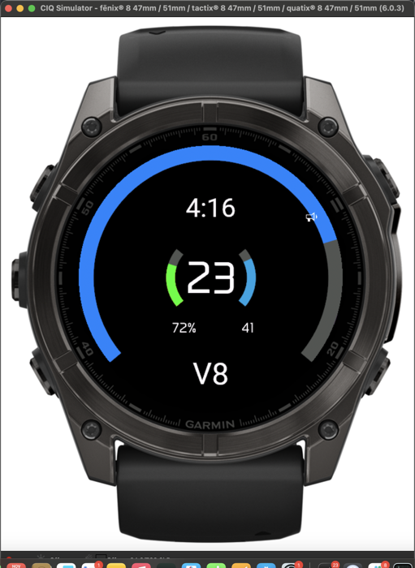
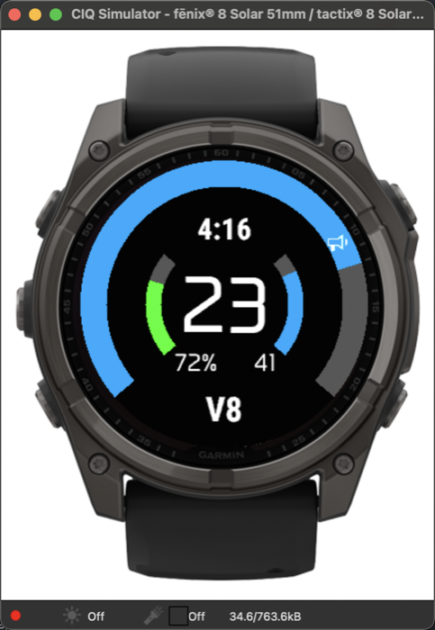

# ⌚️ FedWheel

WheelLog companion for Garmin watches, continued. Fork of
[Wheellog/Companion.Garmin](https://github.com/Wheellog/Companion.Garmin) by ggoraa, which stopped being
maintained in 2022 and does not support newer watches such as the fēnix 8.

FedWheel shows live data from an electric unicycle on the watch. The phone does the talking to the wheel:

```
wheel ──BLE──> WheelLog (Android) ──Connect IQ──> FedWheel (watch)
```

This matters for older wheels (e.g. InMotion V5/V8/V10): Garmin watches cannot talk to them directly
(20-byte BLE packets), but WheelLog can, and FedWheel shows what WheelLog receives.

License: **GPLv3** (same as upstream).

| fēnix 8 AMOLED 47/51 mm | fēnix 8 Solar 51 mm |
|--|--|
|  |  |

## Supported watches

Everything upstream supported, plus fēnix 8: AMOLED 43 mm (`fenix843mm`), AMOLED 47/51 mm (`fenix847mm`),
Pro 47 mm (`fenix8pro47mm`), Solar 47 mm (`fenix8solar47mm`), Solar 51 mm (`fenix8solar51mm`).

## Install (sideload)

1. Install [WheelLog](https://github.com/Wheellog/Wheellog.Android/releases) on the Android phone (free) and
   connect it to the wheel.
2. Build `FedWheel.prg` for your watch (below).
3. Connect the watch by USB. On macOS use [OpenMTP](https://openmtp.ganeshrvel.com). Copy the `.prg` into
   `GARMIN/APPS/` and disconnect.
4. WheelLog → Settings → Watch → enable **Garmin Connect IQ** (beta toggle **off**).
5. Start **FedWheel** on the watch.

## Build

Requires the [Connect IQ SDK](https://developer.garmin.com/connect-iq/sdk/) (SDK Manager, with device files
for your watch) and a developer key:

```sh
openssl genrsa -out key.pem 4096
openssl pkcs8 -topk8 -inform PEM -outform DER -in key.pem -out developer_key.der -nocrypt

monkeyc -l 0 -r -f monkey.jungle -d fenix847mm -y developer_key.der -o bin/FedWheel.prg
```

Tests (start the simulator first with `connectiq`):

```sh
./scripts/test.sh            # default device fenix847mm
./scripts/test.sh fenix8solar51mm
```

## Decisions

- **App UUID kept** (`487e6172-972c-4f93-a4db-26fd689f935a`, WheelLog "stable" companion). The WheelLog phone
  app only talks to the two upstream UUIDs, so a new UUID would need a custom phone build. Only the display
  name changed to FedWheel.
- **kumitateru dropped** for the standard `manifest.xml` + `monkey.jungle`. kumitateru is unmaintained;
  the standard toolchain works with every current SDK. Resources moved to `resources-<device>` /
  `resources-<lang>` folders.
- **Type checking off (`-l 0`)**, as upstream (`type_check_level = 0`). SDK 9 defaults to strict checking,
  which the old code does not pass. Turning it on is future cleanup.
- **No direct-to-wheel mode.** Rejected because of Garmin's 20-byte BLE limit with pre-V11 InMotion wheels.
  For newer wheels see [WheelDash](https://github.com/blkfribourg/WheelDash).

## Credits

Original app by [ggoraa](https://github.com/ggoraa) and the WheelLog team. Translations from the upstream
[POEditor project](https://poeditor.com/join/project?hash=WUAV6h3bxB).
